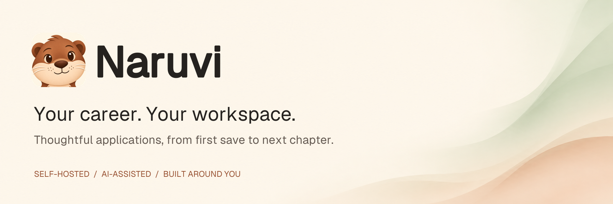
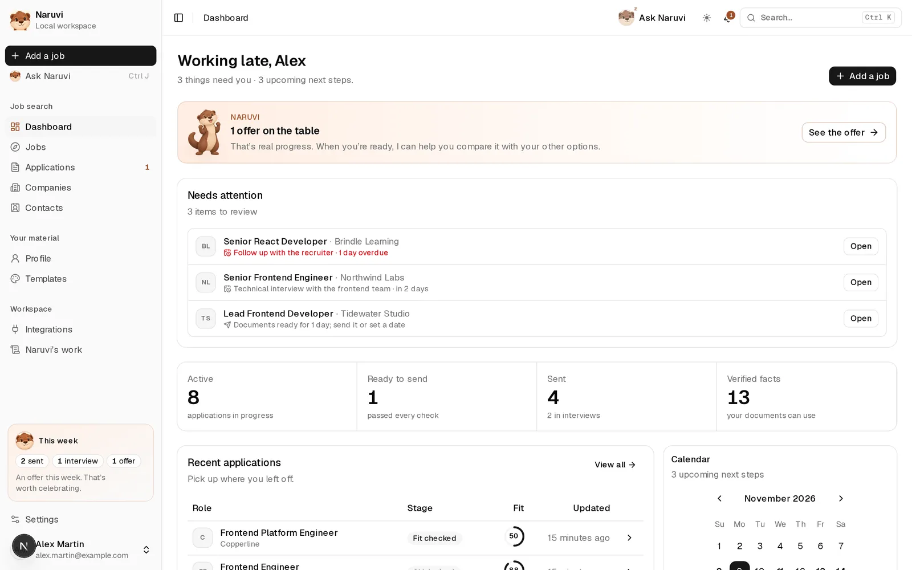
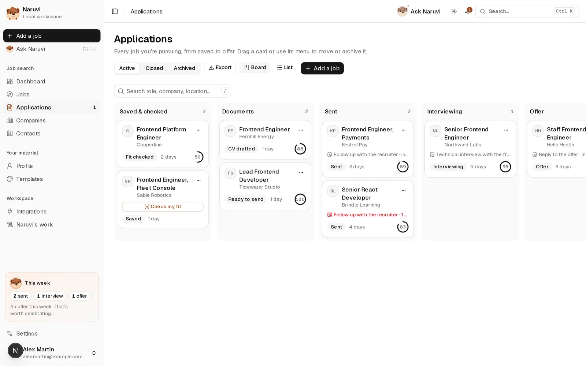
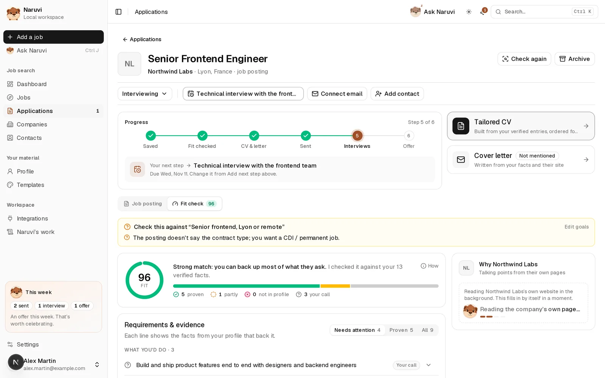
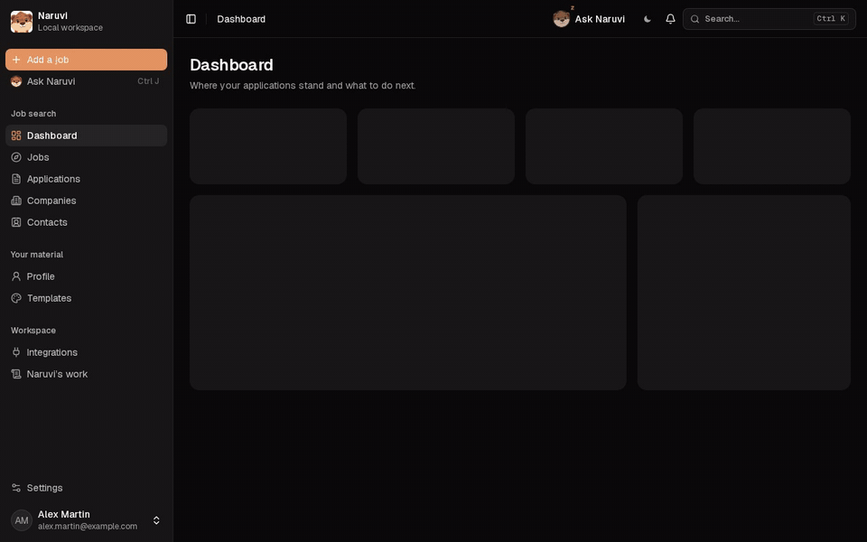
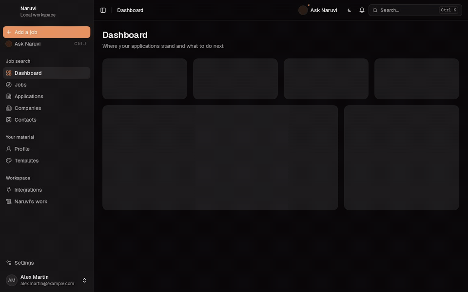
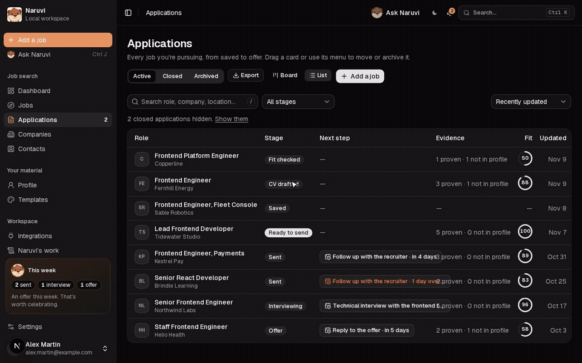
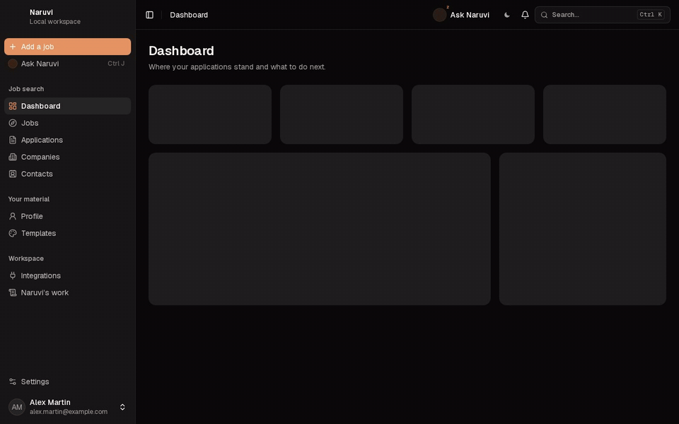

<a id="readme-top"></a>

<p align="center">
  
</p>

<h3 align="center">A calmer way to find your next role.</h3>

<p align="center">
  Save opportunities, understand your fit, tailor your documents, and keep every conversation in one place.<br />
  Self-hosted, AI-first, and grounded in facts you’ve verified.
</p>

<p align="center">
  <a href="https://github.com/Eljakani/naruvi-app/actions/workflows/checks.yml"></a>
  <a href="LICENSE"></a>
  <a href="docs/INSTALLATION.md"></a>
  
  <a href="https://github.com/Eljakani/naruvi-app/commits/main"></a>
  <a href="CONTRIBUTING.md"></a>
</p>

<p align="center">
  <a href="#quick-start"><strong>Quick start</strong></a> ·
  <a href="#see-it-in-action">Demos</a> ·
  <a href="#features">Features</a> ·
  <a href="docs/SELF-HOSTING.md">Self-hosting guide</a> ·
  <a href="#documentation">Docs</a> ·
  <a href="CONTRIBUTING.md">Contribute</a> ·
  <a href="https://github.com/Eljakani/naruvi-app/issues">Issues</a>
</p>

---

<p align="center">
  <picture><source media="(prefers-color-scheme: dark)" srcset="docs/assets/screenshots/dashboard-dark.webp" /></picture>
</p>

<table>
  <tr>
    <td width="50%"><picture><source media="(prefers-color-scheme: dark)" srcset="docs/assets/screenshots/board-dark.webp" /></picture><p align="center"><sub>Every application on one board, with its fit score</sub></p></td>
    <td width="50%"><picture><source media="(prefers-color-scheme: dark)" srcset="docs/assets/screenshots/application-dark.webp" /></picture><p align="center"><sub>Progress, next step, and a fit check you can trust</sub></p></td>
  </tr>
</table>

<p align="center"><sub>Screenshots use a demo workspace with made-up people and companies.</sub></p>

## See it in action

<details open>
<summary><strong>Add a job, check your fit</strong>: Paste a posting. Naruvi reads it, you review and save, and one click compares every requirement with your verified facts.</summary>
<br />
<p align="center"></p>
</details>

<details>
<summary><strong>A reply arrives</strong>: A recruiter writes back. Naruvi links the email to the right application and offers to move it to Interviewing.</summary>
<br />
<p align="center"></p>
</details>

<details>
<summary><strong>Tailor your CV</strong>: One click writes a CV for this job from your verified facts, then lets you refine it by asking.</summary>
<br />
<p align="center"></p>
</details>

<details>
<summary><strong>Keep applications moving</strong>: Drag a card across the board, or mark an application as sent from its page.</summary>
<br />
<p align="center"></p>
</details>

<details>
<summary><strong>Ask Naruvi</strong>: Ask about your search in plain words. Naruvi answers from your workspace.</summary>
<br />
<p align="center"></p>
</details>

<p align="center"><sub>Recorded on a demo workspace with made-up people and companies.</sub></p>

## Why Naruvi

Job searching leaves a trail of tabs, documents, spreadsheets, and emails. Naruvi brings that work together in a workspace **you run yourself**, with an otter companion to help you take the next step.

Start with your experience and verified facts. Save a role, see where your evidence fits, then prepare a CV, cover letter, or email for review. Track the application through interviews and offers without losing the conversation.

- 🧠 **AI-first, you in charge.** Connect your own model. Naruvi analyses every role, researches companies, and drafts documents and emails. You review every draft and decide the next action.
- 🔎 **Evidence before eloquence.** Drafts are built from facts you’ve verified, and document checks flag claims you can’t back up.
- 🏠 **Your data, your server.** One PostgreSQL database and your own asset storage. Saved credentials are encrypted at rest.
- 🔌 **Bring your model.** Native Anthropic support and any OpenAI-compatible endpoint, including local Ollama.

> [!NOTE]
> Naruvi is under active development. Back up your database, uploaded assets, and encryption key before upgrading. The default setup is meant for a trusted local environment.

## Quick start

You need Git and OpenSSL. If Docker isn’t installed, the installer offers to set it up for you (Linux, or macOS with Homebrew). Node.js isn’t needed on the host.

```bash
curl -fsSLo install-naruvi.sh https://raw.githubusercontent.com/Eljakani/naruvi-app/main/install.sh
less install-naruvi.sh   # read it first
bash install-naruvi.sh
```

The guided installer asks where Naruvi runs, then sets it up:

- **Local:** on this computer.
- **Hosted:** on your domain, with automatic HTTPS.
- **Behind your proxy:** Coolify, Traefik, or nginx.

It ends with a private owner setup link. After that, the `naruvi` command handles status, logs, backups, and updates. To try the installer screens without installing anything, run it with `--preview`. See the [installation guide](docs/INSTALLATION.md) for details.

<details>
<summary><strong>Docker Compose from a checkout</strong></summary>

<br />

Requires Git, Node.js 24, and Docker Compose. Node is only used to generate the encryption key; the app runs in containers.

```bash
git clone https://github.com/Eljakani/naruvi-app.git
cd naruvi-app
npm ci
npm run settings:key -- .env
docker compose --profile full up --build -d
```

Open **[localhost:3000](http://localhost:3000)** and follow the setup guide. Compose starts PostgreSQL, applies migrations, and launches the app and the worker. Data and uploaded assets persist in named volumes.

</details>

<details>
<summary><strong>Local development</strong></summary>

<br />

```bash
npm ci
npm run browser:install
cp .env.example .env.local
npm run settings:key
npm run db:up
npm run db:migrate
npm run dev
```

Set up your model in **Integrations → Language model**. To check the development queue connection, run `npm run worker` in a second terminal.

</details>

## Features

<table>
  <tr>
    <td width="33%" valign="top">
      <br />
      <strong>Capture opportunities</strong><br />
      <sub>Import a job URL, paste a posting, or save a page with the browser extension. Job-alert emails become leads.</sub>
    </td>
    <td width="33%" valign="top">
      <br />
      <strong>Check your fit</strong><br />
      <sub>Compare each requirement with your verified evidence, see the gaps, and tell real qualifications apart from perks and instructions.</sub>
    </td>
    <td width="33%" valign="top">
      <br />
      <strong>Research companies</strong><br />
      <sub>AI overviews with sources, built from official websites, verified Wikidata facts, and Wikipedia.</sub>
    </td>
  </tr>
  <tr>
    <td valign="top">
      <br />
      <strong>Tell your story</strong><br />
      <sub>Tailor CVs and cover letters from your facts. Review AI rewrites, restore earlier wording, and export the result.</sub>
    </td>
    <td valign="top">
      <br />
      <strong>Keep applications moving</strong><br />
      <sub>Track stages, next steps, interviews, and offers. The dashboard shows what needs you and how far your applications get.</sub>
    </td>
    <td valign="top">
      <br />
      <strong>Handle the conversation</strong><br />
      <sub>Emails are matched to applications by company, domain, role, recruiter, and thread. Draft replies and follow-ups in context.</sub>
    </td>
  </tr>
  <tr>
    <td valign="top">
      <br />
      <strong>Plan the next step</strong><br />
      <sub>Save interviews or tentative holds, download <code>.ics</code> events, and subscribe to your private calendar feed.</sub>
    </td>
    <td valign="top">
      <br />
      <strong>Build relationships</strong><br />
      <sub>Manage recruiters and contacts, import CSV, Excel, or LinkedIn connections, and start spontaneous applications.</sub>
    </td>
    <td valign="top">
      <br />
      <strong>Ask Naruvi</strong><br />
      <sub>An assistant that knows your workspace and proposes actions for you to review before anything changes.</sub>
    </td>
  </tr>
</table>

### Connect what you use

| Area | Integrations |
| :--- | :--- |
| **Models** | Anthropic, any OpenAI-compatible API, local Ollama |
| **Mail** | IMAP/SMTP, Google or Microsoft OAuth with your own registered app (Microsoft OAuth: work/school accounts only, not personal Outlook.com/Hotmail) |
| **Calendar & alerts** | `.ics` downloads, a private calendar feed, ntfy notifications |
| **Speech** | Local Whisper in the browser, or a cloud provider with your own key |
| **Automation** | Browser extension, [REST API](docs/API.md), MCP server |
| **Transparency** | Every AI workflow’s status, attempts, latency, and token usage in **Runs** |

Mailbox sign-in depends on the provider. Some accounts need OAuth or an app password, and IMAP/SMTP access must be turned on. See the [integration details](docs/SELF-HOSTING.md#integrations).

## Data and privacy

- **Where data lives:** your workspace is stored in your own PostgreSQL database and asset storage.
- **Credentials:** saved model credentials are encrypted with AES-256-GCM. Back up `SETTINGS_ENCRYPTION_KEY` separately, and share it between the app and the worker.
- **What leaves your server:** self-hosting doesn’t make external services offline. Your model provider receives the context a workflow needs, and connected email or notification services receive their relevant data. Local models reduce reliance on hosted AI.
- **Access:** default Compose ports bind to localhost, and the owner account is created through a private terminal link. Use HTTPS and network protections before exposing Naruvi to the internet. See the [security policy](SECURITY.md).

## Documentation

| Guide | What you’ll find |
| :--- | :--- |
| [Installation](docs/INSTALLATION.md) | The guided installer, its modes, and unattended installs |
| [Self-hosting](docs/SELF-HOSTING.md) | Model setup, integrations, backups, and migration notes |
| [Architecture](docs/ARCHITECTURE.md) | Design principles and how the pieces fit |
| [REST API](docs/API.md) | API keys and programmatic access |
| [Browser extension](extension/README.md) | Save postings and contacts from your browser |
| [Document generation](docs/adr/0001-cv-rendering-and-generation.md) | How CVs and letters are rendered and generated |
| [Naruvi’s voice](docs/NARUVI-VOICE.md) | The companion’s tone and product identity |

**Built with** Next.js · React · TypeScript · PostgreSQL + pgvector · Drizzle · Vercel AI SDK · pg-boss · Tailwind CSS

## Contributing

Bug reports, documentation fixes, accessibility improvements, integrations, and tests are all welcome. Start with [CONTRIBUTING.md](CONTRIBUTING.md), or [open an issue](https://github.com/Eljakani/naruvi-app/issues/new/choose) with a focused problem or proposal.

Before opening a pull request, run:

```bash
npm run typecheck
npm run lint
npm test
```

> [!IMPORTANT]
> Use synthetic profiles and sanitized emails in reports and fixtures. Never share real credentials, private CVs, or mailbox exports.

<a href="https://github.com/Eljakani/naruvi-app/graphs/contributors">
  
</a>

## License and credits

Naruvi is licensed under the [Apache License 2.0](LICENSE). Third-party components and assets keep their own licenses, including [Rare UI](licenses/rare-ui.txt) and the [provider logos](public/provider-logos/LICENSE.txt).

The Naruvi otter is the project’s companion. The banner uses the app’s **Geist** typeface and logo; its background was generated with AI. See the [asset notes](docs/assets/README.md).

<p align="right"><a href="#readme-top">Back to top ↑</a></p>
